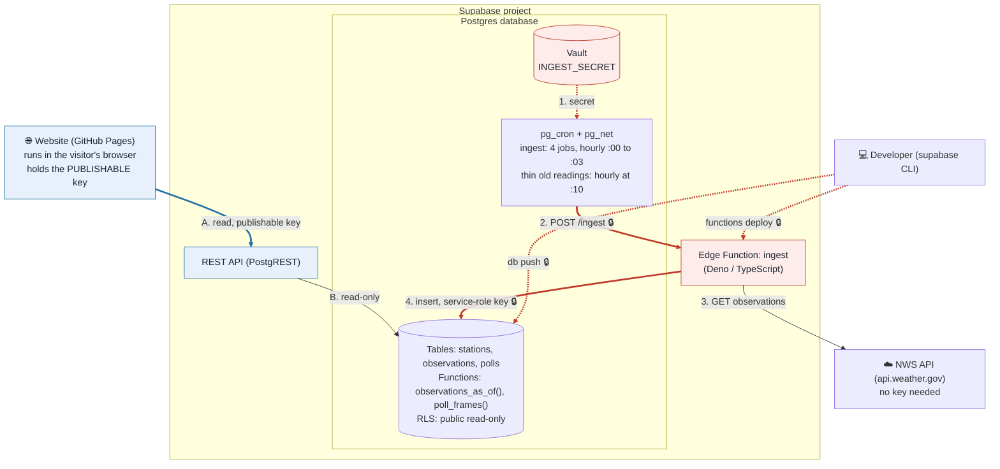
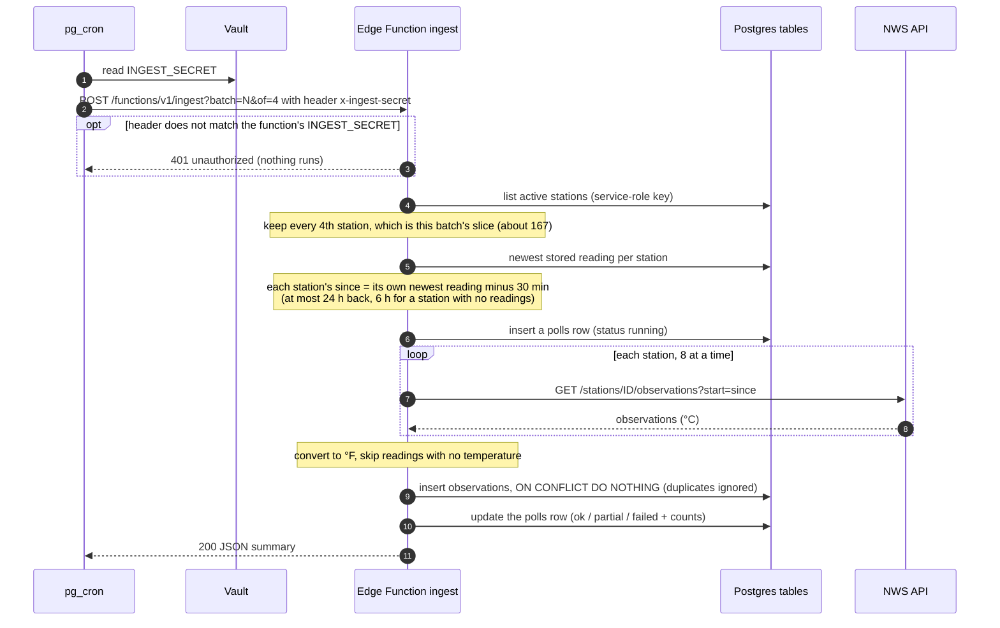
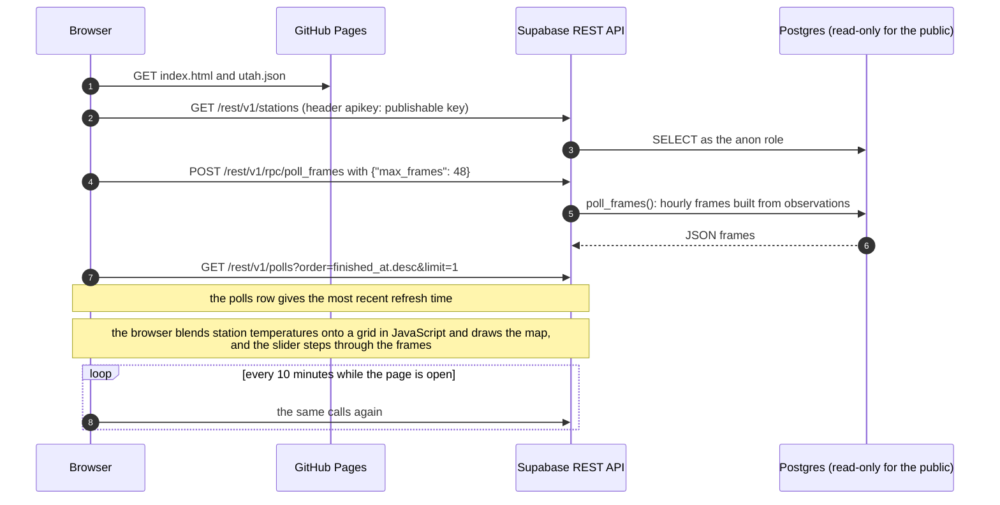

# Utah weather pipeline

A data pipeline that pulls live National Weather Service station observations, stores them in a database, and shows
them as a color-shaded map of Utah (blue = cold, red = hot) with a slider to see how temperatures changed over time.

**Live site:** https://jrj221.github.io/cs452-data-pipeline-project/

## Architecture



🔒 **red** = involves a secret · **blue** = uses only the public key. Steps **1–4** are the hourly **ingest** (write path);
steps **A–B** are what happens when someone opens the site (read path). Details of both are in the sequence diagrams below.

### What lives in Supabase

| Piece | What it does |
|---|---|
| **Tables** | `stations` (the ~667 tracked stations), `observations` (one row per station and reading time), `polls` (a log of ingest runs) |
| **Read functions** | `observations_as_of()` returns the map at a given time; `poll_frames()` returns the hourly snapshots for the slider |
| **Row-level security** | The public key can only read. Only the ingest function (service role) can write |
| **REST API** | Generated by Supabase from the tables and functions. The website calls it |
| **Edge Function `ingest`** | Fetches NWS readings for one batch of stations and stores them. Stations are split into 4 batches to stay under the 2 s CPU limit |
| **pg_cron + pg_net** | Hourly jobs: four ingest calls (:00 to :03), and a cleanup job (:10) that keeps one reading per station per hour |
| **Vault + function secrets** | `INGEST_SECRET` is stored in both. Cron sends it, and the function checks it |

### Secret vs. public credentials

| Credential | Lives in | Public? | Used for |
|---|---|---|---|
| Project URL / ref | `docs/index.html`, the schedule migration | **Public**. It's in every URL | Addressing the project |
| **Publishable key** (`sb_publishable_…`) | `docs/index.html` | **Public by design** | The website's read-only API calls. Row-level security means it can't write anything |
| **`INGEST_SECRET`** | Supabase **Vault** *and* Edge Function secrets (same value) | 🔒 **Secret**. Never in the repo | Proves a call to `ingest` came from the cron job. Cron sends it in the `x-ingest-secret` header, and the function compares it to its copy |
| **Service-role key** | The Edge Function's environment only (provided by Supabase) | 🔒 **Secret** | Lets `ingest` write to the tables, bypassing row-level security. Never in browser code |
| **Database password** | Your password manager | 🔒 **Secret** | Only the CLI (`supabase db push`) uses it |
| **Supabase CLI login token** | The CLI's own storage (`supabase login`) | 🔒 **Secret** | Deploying migrations and functions |
| NWS API | Nothing | n/a | No key. Requests only need a `User-Agent` header |

### The hourly ingest (write path)



### Reading the data (read path)



### How the APIs are called

| Call | Caller | Auth | Purpose |
|---|---|---|---|
| `POST /rest/v1/rpc/poll_frames` | website | `apikey: <publishable key>` | Hourly map frames for the slider |
| `POST /rest/v1/rpc/observations_as_of` | anyone | `apikey: <publishable key>` | The map at one moment (now, or a past time) |
| `GET /rest/v1/stations`, `/observations?…`, `/polls?…` | anyone | `apikey: <publishable key>` | Station list, one station's history, pipeline health |
| `POST /functions/v1/ingest?batch=N&of=4` | pg_cron (or you, by hand) | 🔒 `x-ingest-secret: <INGEST_SECRET>` | Run the ingest for one batch |
| `GET api.weather.gov/stations/ID/observations?start=…` | the ingest function | none (`User-Agent` only) | Fetch observations |

Read the current map from a terminal (the publishable key is safe to use here):
```bash
curl -s -X POST "https://<project-ref>.supabase.co/rest/v1/rpc/observations_as_of" \
  -H "apikey: <publishable key>" -H "Content-Type: application/json" -d '{}'
```
Trigger the ingest by hand (needs the secret; `read -s` keeps it out of your shell history):
```bash
read -s INGEST
for b in 0 1 2 3; do
  curl -s -X POST "https://<project-ref>.supabase.co/functions/v1/ingest?batch=$b&of=4" -H "x-ingest-secret: $INGEST"; echo
done
```

## Reliability, secrets and cost

### Idempotency

NWS returns a window of readings ("everything since X"), not just what's new, and each run deliberately re-requests the
last 30 minutes, so overlapping data is expected. Duplicates can't get in:
- **Unique key:** `observations` has the primary key `(station_id, observed_at)`, so a reading is identified by its
  station and timestamp.
- **Upsert that skips existing rows:** inserts use `ON CONFLICT DO NOTHING`. Readings never change, so there is nothing to update.
- **Same timestamp twice in one response** is collapsed before inserting.
- **Newest reading per station** is computed when it's read (`distinct on (station_id) … order by observed_at desc` in
  `observations_as_of`). It's the same idea as an arg_max view, without materializing it at this size.
- **Tested:** running the ingest twice on the same data inserts 0 rows the second time. The hourly cleanup is also safe
  to repeat, since a second run deletes nothing.

### Gaps and failure handling

- **Seed and trickle:** the seed is the first run's 6-hour lookback, and the trickle is the hourly job after it. There's
  no gap between them, because every run starts each station from **its own newest stored reading minus 30 minutes**,
  so it always overlaps what is already stored. NWS observations are close to real time, so there's no multi-day archive
  lag to bridge.
- **Fetching nothing new is normal:** stations report every 5 to 60 minutes, so some runs find nothing for some
  stations. A 404 from NWS means "no observations" and is treated as an empty result, not an error. The run is still
  logged in `polls`, with `new_rows` possibly 0.
- **API down at 3 a.m.: backfill, not skip.** The next run that works asks for everything since each station's newest
  stored reading, so the missed hours are filled in. Skipping would leave a permanent hole in data that still exists
  upstream, and the primary key makes the re-fetch harmless.
  - Each station fetch is retried up to 3 times with a short delay (for 429, 5xx and network errors).
  - A station that still fails is counted in `stations_failed`, and the rest of the batch is stored. The run is logged as
    `ok` (20% or fewer failed), `partial` (more than 20%), or `failed` (every station, or a database error).
  - A failed station isn't skipped next time, because its start time comes from its own last reading, not from when the
    batch last succeeded. (An earlier version used a per-batch start time and had this flaw; there's a regression test.)
  - The lookback is capped at 24 hours, so a longer outage leaves a gap. Outages are visible on the site: "Most recent
    refresh" turns orange after 2.5 hours, and an hour with no readings in range has no slider frame.

### Secrets management

No credential is stored in this repo. Each secret lives in the platform's own secret store, and the code reads it only
at run time. The table under *Secret vs. public credentials* lists them all. How they're handled:
- **Where they live:** `INGEST_SECRET` is in Supabase **Vault** (the cron job reads it with a SQL lookup when it runs)
  and in Supabase **Edge Function secrets** (the function reads it as an environment variable). The **service-role key**
  exists only in the function's environment, provided by Supabase. The **database password** is in a password manager,
  and the CLI prompts for it.
- **Nothing sensitive in the code:** the schedule migration looks the secret up in Vault instead of containing it, and the
  website holds only the publishable key and project URL. Those are public by design, and row-level security makes them
  read-only.
- **Creating a secret without exposing it:** `openssl rand -hex 32 | pbcopy`, paste it into the Vault UI, then
  `supabase secrets set INGEST_SECRET="$(pbpaste)"`. The value never goes into a file or the shell history.
- **Guard rails:** `.gitignore` excludes `.env`, `.env.*` and `supabase/.temp/`. The ingest returns 401 to any call
  without the right header.
- **Checked:** every commit in the history was scanned for keys, tokens and password patterns before publishing. The
  only key found is the public publishable key.
- **No GitHub Actions secrets are needed:** nothing runs in CI. Supabase's own `pg_cron` is the scheduler, and deploys
  are done from the CLI.
- **If one leaks, rotate it:** set a new `INGEST_SECRET` in both Vault and the function secrets, or reset the
  service-role key in the dashboard. Deleting the commit isn't enough, because git history keeps it.

### Cost accounting

**Actual spend: $0.** Everything runs on free tiers.

| Service | Plan | What this project uses | Free allowance |
|---|---|---|---|
| Supabase (database, REST API, Edge Function, `pg_cron`, Vault) | Free | ~13 MB database so far (the `observations` table is a few MB of that), growing to roughly 25 MB over a week, ~96 function calls a day (about 2,900 a month) | 500 MB database, 500,000 function calls a month, unlimited API requests, 5 GB bandwidth |
| GitHub Pages | Free (public repo) | a static site of a few hundred KB | none that matter at this size |
| NWS API | Free, no key | about 670 requests an hour | rate limit isn't published |

- **Why it stays at $0:** every limit has a large margin, and nothing needs a paid feature. The hourly cleanup keeps the
  table to about 13 MB a week (about 46 MB if every reading were kept), so storage can't creep up.
- **Staying up:** Supabase pauses free projects after about a week of low database activity. The hourly ingest writes
  to the database every hour, which should count as activity. Paused projects aren't billed.
- **Teardown when the follow-up assignment is done:** unschedule the five cron jobs (`select cron.unschedule('<name>')`),
  run `supabase functions delete ingest`, delete the Supabase project (Dashboard, Project Settings, General), and
  delete the GitHub repo or turn off Pages.

## Repo layout

- `supabase/`: database schema (migrations), the ingest Edge Function, and the hourly schedule. Setup steps are in
  [supabase/README.md](supabase/README.md).
- `docs/`: the website. GitHub Pages serves it (Settings, Pages, deploy from branch `main`, folder `/docs`).
- `observations.json`: the fixed list of stations tracked. `build_config.py` regenerates it.
- `make_map.py`: an earlier standalone script that builds a one-off `map.html` straight from NWS (no database).
- `build_site_geo.py`: generates `docs/utah.json` (state outline and counties) for the site.

Secrets (the ingest secret, database password, service-role key) are never stored in this repo.
